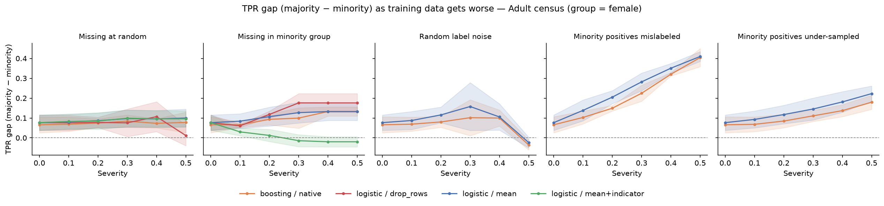
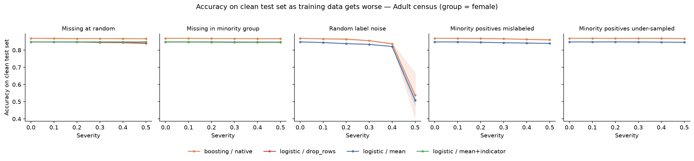

# Data-Quality Stress Test: When Bad Training Data Hurts Accuracy, Fairness, or Both

**Question:** How much do common problems in training data (missing values, wrong labels, unrepresentative samples) change a model's **accuracy** and its **fairness across groups**? And does the way we handle missing data matter?

Coming from educational measurement, I spent a lot of time on missing data and sampling. This project asks what those same problems do to ML models.

## Design

Training data is corrupted in controlled ways; every model is evaluated on the same **clean** test set.

| Corruption | What happens to the training data |
|---|---|
| Missing at random | Numeric values removed at random (MCAR) |
| Missing in minority group | Same missing budget, concentrated in the minority group |
| Random label noise | A share of labels flipped |
| Minority positives mislabeled | Positive labels in the minority group flipped to negative |
| Minority positives under-sampled | Minority-group positive examples dropped (selection bias) |

- **Severity:** 0% to 50% in steps of 10%
- **Setups:** logistic regression with mean imputation, mean imputation + missing indicator, or row deletion; and gradient boosting with native missing-value handling
- **Metrics:** accuracy, and the **true-positive-rate gap** between groups (equal opportunity)
- **Seeds:** 3 train/test splits; shaded bands in the figures show ± 1 SD

## Quick start

```bash
pip install -r requirements.txt
python stress_test.py --dataset adult --outdir results/adult      # UCI Adult census (downloads from OpenML)
python plot_results.py --inp results/adult/results.csv --outdir results/adult

python stress_test.py --dataset synthetic --outdir results/synthetic   # offline, simulated data
python plot_results.py --inp results/synthetic/results.csv --outdir results/synthetic
```

## Results on simulated data

These come from `--dataset synthetic`, a simulated dataset, so they illustrate the method rather than a real-world finding.


**Main pattern:** mislabeling half of the minority group's positive cases cut logistic-regression accuracy by only about 5 points, but widened the TPR gap between groups by about 43 points. **Accuracy alone would hide the harm.** Random label noise showed the opposite pattern: a large accuracy drop with little change in the gap.

Other observations:
- Dropping rows with any missing value was the worst strategy under random missingness (−12 points of accuracy at 50%); mean imputation was almost unaffected.
- Gradient boosting was more robust than logistic regression to group-targeted label noise in this setup.

## Results on Adult census data

UCI Adult (n = 45,222 after removing incomplete rows; 25% earn > $50K). The group is **sex**: women (32%) are the minority group. Sex is not used as a feature. The **TPR gap** is the true-positive rate for men minus the rate for women, so a positive gap means qualified women are missed more often.




**Change from clean training data to 50% corruption** (mean of 3 seeds):

| Corruption | Setup | Accuracy change | TPR gap: clean → corrupted |
|---|---|---|---|
| Women's positive labels flipped | logistic / mean | −0.9 pts | 0.08 → **0.41** |
| Women's positive labels flipped | boosting | −0.9 pts | 0.07 → **0.40** |
| Women's positives under-sampled | logistic / mean | −0.2 pts | 0.08 → 0.22 |
| Women's positives under-sampled | boosting | −0.2 pts | 0.07 → 0.18 |
| Missing values concentrated in women | logistic / mean | −0.1 pts | 0.08 → 0.13 |
| Missing values concentrated in women | logistic / row deletion | −0.2 pts | 0.08 → 0.18 |
| Random label noise | logistic / mean | **−33.9 pts** | 0.08 → −0.02 |
| Random missing values | all setups | ≤ −0.8 pts | small changes |

**Main pattern (replicates the simulated results on real data):** mislabeling half of the women's positive cases cost **less than 1 point of accuracy** but raised the TPR gap from about 0.07 to about 0.40. A model checked on accuracy alone would look fine while missing qualified women far more often than qualified men. Random label noise showed the opposite: a large accuracy drop with no added gap.

Other observations:
- **Selection bias** (under-sampling women's positive cases) also widened the gap (+0.11 to +0.15) at almost no accuracy cost.
- **Group-concentrated missingness** widened the gap with mean imputation, row deletion and boosting. Row deletion was the worst (+0.10).
- **Caution on the missing-indicator result:** with mean imputation plus missing indicators, the gap fell to about 0. This is not a fix. Because women are 32% of the data, at high severity all of their numeric values are missing, so the indicators effectively encode sex and let the model use group membership directly. When missingness is tied to a group, missing indicators can act as a proxy for that group.
- Unlike the simulated data, row deletion under random missingness cost little accuracy here (−0.8 pts).

## Limitations

- Corruptions are simple and random, not adversarial or realistic error patterns.
- The group variable is excluded from the features; results may differ when it is included.
- Only two model families and one fairness metric.
- At high severity, group-concentrated missingness removes all numeric values for the minority group (its missing budget is capped at 100%), which is an extreme case.
- Adult is a widely used but dated benchmark; Ding et al. (2021) recommend newer census-based datasets such as ACSIncome.
- 3 seeds give a rough sense of variability, not formal tests.

## Next steps

- Multiple imputation and more realistic missingness (MNAR)
- Detecting corrupted examples (e.g., with confident learning or data attribution) and checking whether removing them restores fairness
- Newer, larger datasets such as ACSIncome (Ding et al., 2021), and education or survey data
- Framing label noise as measurement error in the outcome, expressed as label reliability

## Related work

- Zhu, J., Xu, G., Lorenzi, F., Glavic, B., & Salimi, B. (2025). *Stress-Testing ML Pipelines with Adversarial Data Corruption.* arXiv:2506.01230. Inspired the question; this project uses simpler, non-adversarial corruptions.
- Hardt, M., Price, E., & Srebro, N. (2016). Equality of opportunity in supervised learning. *NeurIPS.*
- Ding, F., Hardt, M., Miller, J., & Schmidt, L. (2021). Retiring Adult: New datasets for fair machine learning. *NeurIPS.*
- Little, R. J. A., & Rubin, D. B. (2019). *Statistical Analysis with Missing Data* (3rd ed.). Wiley.
