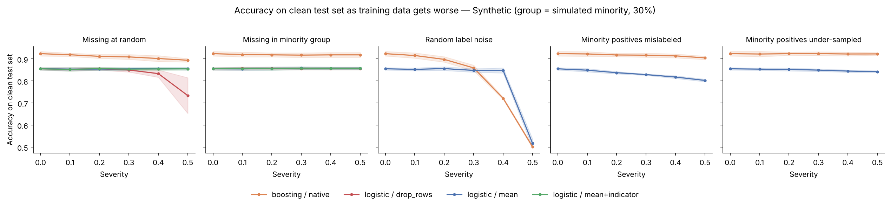
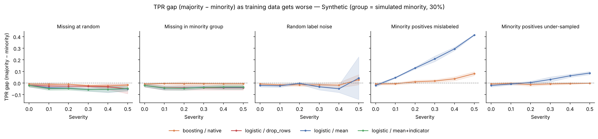

# Results: Synthetic (group = simulated minority, 30%)

Seeds: 3 | Severities: 0, 0.1, 0.2, 0.3, 0.4, 0.5

## Change from clean training data to the worst severity
| corruption        | setup                     |   acc_clean |   acc_worst |   tpr_gap_clean |   tpr_gap_worst |   acc_change |   gap_change |
|:------------------|:--------------------------|------------:|------------:|----------------:|----------------:|-------------:|-------------:|
| label_noise       | boosting / native         |       0.924 |       0.501 |          -0.008 |           0.029 |       -0.423 |        0.037 |
| label_noise       | logistic / mean           |       0.856 |       0.517 |          -0.021 |           0.042 |       -0.339 |        0.063 |
| label_noise_group | boosting / native         |       0.924 |       0.905 |          -0.008 |           0.081 |       -0.019 |        0.089 |
| label_noise_group | logistic / mean           |       0.856 |       0.803 |          -0.021 |           0.414 |       -0.053 |        0.435 |
| missing_group     | boosting / native         |       0.924 |       0.919 |          -0.008 |          -0.006 |       -0.005 |        0.002 |
| missing_group     | logistic / drop_rows      |       0.856 |       0.857 |          -0.021 |          -0.041 |        0.001 |       -0.02  |
| missing_group     | logistic / mean           |       0.856 |       0.858 |          -0.021 |          -0.037 |        0.002 |       -0.016 |
| missing_group     | logistic / mean+indicator |       0.856 |       0.857 |          -0.021 |          -0.034 |        0.002 |       -0.013 |
| missing_random    | boosting / native         |       0.924 |       0.894 |          -0.008 |          -0.017 |       -0.03  |       -0.009 |
| missing_random    | logistic / drop_rows      |       0.856 |       0.734 |          -0.021 |          -0.05  |       -0.121 |       -0.029 |
| missing_random    | logistic / mean           |       0.856 |       0.856 |          -0.021 |          -0.05  |        0.001 |       -0.029 |
| missing_random    | logistic / mean+indicator |       0.856 |       0.855 |          -0.021 |          -0.046 |       -0     |       -0.025 |
| selection_bias    | boosting / native         |       0.924 |       0.923 |          -0.008 |          -0.001 |       -0.001 |        0.007 |
| selection_bias    | logistic / mean           |       0.856 |       0.843 |          -0.021 |           0.086 |       -0.013 |        0.107 |

## Headline
- Largest accuracy drop: **Random label noise** with boosting / native (-0.423).
- Largest fairness harm (TPR gap increase): **Minority positives mislabeled** with logistic / mean (+0.435).
- Compare the two: corruptions that barely move accuracy can still widen the gap between groups.

